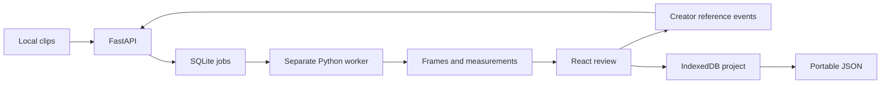

# Continuity Detective — Technical Spec

## How This Works, In Plain Language

The React workbench runs in a browser on the creator's computer. Videos go to the local FastAPI service, not a cloud service. A separate Python worker prepares actual frames and proposes a visible torso region. No wardrobe comparison runs before the creator confirms the reference frame and crop.

For each sampled frame, the worker locates the torso and measures its colour distribution against the applicable reference. It returns real frames, crops, positions, measurements, and reasons it could not assess a comparison. This is measured appearance difference, not proof of a different garment or inferred narrative error.

The creator supplies intent. “New wardrobe from here” adds a reference boundary to the ordered sequence. Earlier frames retain their earlier reference; subsequent frames use the new reference until another boundary. The browser saves references, results, decisions, and thumbnails locally. JSON export includes evidence and history.

This draft recommends local CPU analysis, body-landmark torso proposals, colour comparison, a SQLite worker queue, and IndexedDB persistence. The learner approved these recommendations; they are not yet implemented or validated capabilities.

## The Core Journey Through the System

Implements `prd.md > The Core Journey`.

1. Browser uploads clips to the loopback API. The service hashes/stores each file locally and queues preparation. The worker probes source timestamps/orientation, extracts previews, and proposes torso regions.
2. The browser displays clips in creator-selected order and proposes the earliest usable sampled frame. The creator can seek elsewhere, adjust the crop, and confirm.
3. Browser commits the reference locally and submits an immutable analysis snapshot containing clip order, references, configuration, and project revision.
4. Worker applies quality gates, selects the appropriate reference, computes appearance distance, and saves evidence/results. Browser polls progress and persists the completed bundle.
5. Selecting a finding seeks each A/B player to its own recorded source position. Exact extracted evidence stills establish the analysed pixels; browser seeking alone is not the evidence authority.
6. A confirmed reference change increments revision and starts a new run. Unchanged evidence retains decisions; changed evidence starts fresh, retaining old results as historical.
7. Undo restores the previous reference configuration and cached results. Export embeds small evidence images, so JSON remains interpretable outside the session.
8. Reopening restores the saved project without re-analysis. Browser checks local media availability and offers relinking when necessary.



## Stack

| Piece | Dependency and rationale | Documentation |
| --- | --- | --- |
| Frontend | React + TypeScript + Vite, user-selected; plain CSS and native SVG overlays avoid a UI framework | [React](https://react.dev/learn), [TypeScript](https://www.typescriptlang.org/docs/), [Vite](https://vite.dev/guide/) |
| API | Python 3.11, FastAPI, Pydantic, Uvicorn, python-multipart; typed local uploads | [FastAPI uploads](https://fastapi.tiangolo.com/tutorial/request-files/), [Pydantic](https://docs.pydantic.dev/latest/), [Uvicorn](https://www.uvicorn.org/) |
| Worker queue | Separate Python process, standard-library SQLite, one worker; no Redis/Celery | [sqlite3](https://docs.python.org/3.11/library/sqlite3.html) |
| Media | FFmpeg/ffprobe for decoding, orientation and actual source frame times | [FFmpeg](https://ffmpeg.org/ffmpeg.html), [ffprobe](https://ffmpeg.org/ffprobe.html) |
| Torso proposal | MediaPipe Tasks Pose Landmarker Lite, shoulder/hip geometry, optional person segmentation | [Python guide](https://developers.google.com/edge/mediapipe/solutions/vision/pose_landmarker/python), [models](https://developers.google.com/edge/mediapipe/solutions/vision/pose_landmarker) |
| Measurements | OpenCV + NumPy for masks, quality signals, histograms and distance | [OpenCV histogram comparison](https://docs.opencv.org/4.x/d8/dc8/tutorial_histogram_comparison.html), [NumPy](https://numpy.org/doc/stable/) |
| Persistence | Native IndexedDB for project metadata and thumbnail blobs | [IndexedDB](https://developer.mozilla.org/en-US/docs/Web/API/IndexedDB_API) |
| Verification | pytest and Playwright for reference semantics, worker evidence and browser journey | [pytest](https://docs.pytest.org/en/stable/), [Playwright](https://playwright.dev/docs/intro) |

Pin mutually compatible Python packages after the first clean installation; commit the npm lockfile. Resolve MediaPipe/OpenCV/NumPy together and avoid competing OpenCV distributions in one environment. Use MediaPipe Tasks, not an assumed legacy `mp.solutions` API. Exact dependency versions remain an early build check, not an invented compatibility guarantee.

Read-only environment check on 2026-10-26 found Node v26.2.0, Python 3.11 and 3.14, and FFmpeg 8.1.2. Explicitly use Python 3.11. Package imports, model loading, and throughput are unverified. Official documentation was consulted; Uvicorn's documentation lookup timed out.

## Where It Runs and How Someone Tries It

Local Windows development: browser, loopback API, and one separate worker. No API keys or paid inference. Setup needs internet for packages/model; analysis runs locally afterward. Static hosting alone cannot run the Python worker.

Planned setup from repository root; these application files will be created in `5-build`:

```powershell
py -3.11 -m venv .venv
.\.venv\Scripts\python.exe -m pip install -r backend/requirements.txt
.\.venv\Scripts\python.exe -m backend.scripts.fetch_model
npm --prefix frontend install
```

Run each command in a separate terminal at the repository root:

```powershell
.\.venv\Scripts\python.exe -m uvicorn backend.app.main:app --host 127.0.0.1 --port 8000
```

```powershell
.\.venv\Scripts\python.exe -m backend.app.worker
```

```powershell
npm --prefix frontend run dev -- --host 127.0.0.1 --port 5174 --strictPort
```

Open `http://127.0.0.1:5174`; Vite proxies `/api` to port 8000. Keep this browser origin stable for IndexedDB. API development docs: `http://127.0.0.1:8000/docs`.

Proposed initial input envelope: three clips maximum, 30 seconds each, 250 MiB total. Start validation with portrait/landscape MP4/H.264 phone footage. Probe all files; reject unsupported media clearly. Adjust limits after measuring preparation time/storage and display them in import guidance.

Record the approved real-footage demo locally. Submission requires a short video and public GitHub repository; deployment is optional. Do not publish personal footage, local project data, models, or credentials by default. Obtain usable real demo footage before claiming validation.

## Look and Feel

Implements `prd.md > Screens and Layout` and `Look and Feel`.

Plain CSS variables: white `#ffffff`, charcoal `#111111`, muted text `#6b665f`, dividers `#eeeeee`, annotation red `#ba1a1a`. One-page editorial workbench: sticky header, large display headline, measured stats, a horizontal shot reel, then the player and findings. Pill controls, quiet white panels, restrained motion (hero rise, marquee, hover lift, pointer glow). Honour `prefers-reduced-motion`. System-plus-bundled sans for display, system monospace for timestamps; no required remote font.

Desktop: full-width hero and shot reel, large evidence/player centre, findings to the right, timeline beneath evidence. Reference confirmation uses the central preview and filmstrip. Stack panels on narrow screens; the shot reel becomes a horizontal snap scroller. Pair status colour with text. Overlay coordinates account for portrait orientation and letterboxing. Provide labelled keyboard-operable controls and numeric crop adjustment alongside drag handles.

## Components

### Workbench and Project Controller

Implements `prd.md > Screens and Layout`, `States and Boundaries`, and `Local Save and Resume`.

React reducer owns confirmed project/reference state, revision, selected evidence, result reconciliation, and undo. Draft frame/crop edits do not mutate confirmed state. Durable changes save immediately to IndexedDB; UI selection is ephemeral. Save failures stay visible.

### Shot List and Timeline

Implements `prd.md > Import and Sequence Order`.

Picker/drop area, clip order with move-up/down controls, sampled filmstrip, source-video scrubber, and reference boundary markers. Scrubbing can choose non-sampled frames; exact extraction finishes before reference confirmation. Source and sequence positions remain distinct. Reordering increments revision, invalidates affected applicability/results, and shows changed boundaries for confirmation before re-analysis.

### Reference Editor

Implements `prd.md > Initial Reference Confirmation` and `Reference Changes, Correction, and Undo`.

Large preview, normalized SVG crop handles, reset, confirm, and cancel. Initial reference source may be a later clear frame, but its effective scope begins at sequence start. Source frame and effective boundary are separate fields.

New references apply inclusively at the chosen position. Correcting the latest forward reference preserves its preceding segment; constrain its edited boundary to follow the preceding boundary. Preserve replaced versions in the event log. Undo restores the configuration, result-set pointer and decisions saved before the latest reference-changing action. The append-only event log still records that undo. Multiple sequential reference events are supported, one reference per sequence position.

### Local API and Media Store

Implements `prd.md > Import and Sequence Order`, `Local Save and Resume`, and `States and Boundaries`.

Stream uploads into ignored `data/media/`, compute SHA-256 identities, check limits, queue preparation. Serve media/assets by opaque IDs, never user-provided filesystem paths. Support byte-range video responses. Retained local copies enable worker access and resume; missing media is re-uploaded and matched by hash, not filename alone.

Only decoding/proposal/preparation occurs before confirmation. Comparison requests require confirmed references. All CPU-heavy extraction/proposal/comparison runs in the separate worker.

### Analysis Worker and Queue

Implements `prd.md > Analysis and Evidence Inspection` and `States and Boundaries`.

One worker atomically claims SQLite jobs using short transactions, default rollback journal and busy timeout. Job types: `prepare`, `extract_frame`, `analyse`. Store immutable payload, state, phase, progress, heartbeat, result path and error. No project decision authority lives in the queue.

Expose worker heartbeat. Missing heartbeat means offline/interrupted, not indefinite apparent progress. Worker restart marks abandoned running jobs interrupted; page reload never silently replays analysis. Browser polls active jobs about once a second and stops at completion. A stale revision's completion cannot become current.

### Frame Extraction and Torso Proposal

Implements `prd.md > Initial Reference Confirmation` and `Analysis and Evidence Inspection`.

ffprobe supplies actual frame presentation times; FFmpeg supplies rotation-corrected images. Preserve source PTS/time-base, decoded frame ordinal, milliseconds, orientation transform, and working-image size. Never calculate frame numbers as `time * average_fps` for variable-frame-rate media. Preview/proxy positions map back to original source evidence.

Start sampling at 0.5-second intervals, clip endpoints, reference boundaries, and manually selected frames. Disclose coverage: events between samples may be missed. Earliest clear means earliest passing sampled candidate, not an exhaustive scan. A manually selected non-sample queues exact extraction. Stored frame identity/pixels establish exact evidence even if browser video seeking is approximate.

MediaPipe detects up to two poses so multi-person ambiguity can be rejected. Shoulder landmarks and the upper half of the shoulder-to-hip axis yield an upper-torso crop proposal, so seated subjects do not require visible hips. Preserve the full geometry/provenance and reject invalid inferred regions. Preparation must evaluate the exact default rectangle that confirmation will use. Optional person segmentation reduces background but is not clothing segmentation and does not prove unobstructed clothing. Reject low-visibility, off-frame, or geometrically ambiguous proposals. This replaces the suggested face-box expansion with a torso-specific proposal, subject to approval/validation.

Manual crop adjustments are expressed relative to reference torso geometry where possible and mapped onto subsequent detected torsos. Save both requested rectangle and effective polygon/mask. If correspondence cannot be established, return not assessable; do not compare a fixed screen rectangle after the subject moves. Manual selection aids may exist without successful pose detection, but cannot force an assessable comparison.

### Quality Gate and Wardrobe Measurement

Implements `prd.md > Analysis and Evidence Inspection`.

Measure both reference/candidate crop area, normalized blur/sharpness (including strongest valid edges to avoid confusing smooth fabric with blur), exposure clipping, landmark visibility/presence, torso bounds, and mask coverage. Emit reason codes such as `blurred`, `too_small`, `torso_not_visible`, `ambiguous_subject`, `unreliable_correspondence`, or `exposure_extreme`. A failing reference makes its comparisons not assessable and prompts selection of a clearer reference.

Pose visibility is an imperfect occlusion indicator; an object may cover clothing while landmarks remain detectable. Real foreground-occlusion validation is required. If the proposed gates cannot handle it adequately, that is a blocking capability limitation needing a fix or explicit plan revision. Do not call an occluded region a match merely because landmarks exist.

For assessable masked torso regions, compute L1-normalized 2D Lab chroma histograms, initially 16 by 16 bins. Compare with OpenCV Bhattacharyya/Hellinger distance. Display `100 * distance` as **Appearance difference**, explicitly not confidence or probability. Store raw distance, histogram/mask settings, quality metrics, threshold, model identity and algorithm version.

Similar measurements are **No colour difference flagged**, never proof of identical wardrobe. High distance becomes **Wardrobe colour difference — review**. Do not invent garment names, material, missing-layer descriptions or causal explanations. Colour alone can miss a same-colour garment/layer change and can react to lighting. Missing-layer checks require a separately validated method before being claimed.

Keep thresholds in versioned configuration. Provisional development values must be calibrated on labelled real footage, including unchanged clothing under pose/light variation. No LLM, garment classifier, face identity or regeneration service is in the critical path.

### Reference Resolver and Result Reconciliation

Implements `prd.md > Reference Changes, Correction, and Undo`, `Review Decisions`, and `States and Boundaries`.

Order positions as `(clip_order_index, source_pts)`. Applicable reference is the latest boundary less than or equal to that position in the run's immutable snapshot. Reference versions are immutable; corrections create versions.

Comparison fingerprint includes source hashes, exact reference/candidate positions, effective crop/mask hashes, model hash, algorithm/config version, and reference ID. Unchanged fingerprints retain finding IDs/decisions. Changed comparisons create new results, leaving old decisions with superseded evidence. New flagged differences start Needs fix; not-assessable outcomes have no fabricated severity. Record an initiating finding separately on the reference-change event.

Only the current project revision's successful run is promoted. During recomputation, existing results are labelled out of date and cannot be exported as current. On failure preserve historical results and show an explicit retry. Historical export includes superseded status. Undo restores prior result/decision snapshots rather than guessing previous scores.

### Evidence Players and Findings Panel

Implements `prd.md > Analysis and Evidence Inspection` and `Review Decisions`.

A/B players seek independently; exact saved stills show crops, clip names, source times and reference version. Assessment status remains distinct from human disposition. Offer Needs fix, Intentional, False positive and Defer. None adjusts thresholds or future comparisons. Keep not-assessable results inspectable and dismissed/historical findings available without presenting them as current actionable errors.

### Persistence and JSON Export

Implements `prd.md > Local Save and Resume` and `JSON Export`.

IndexedDB stores the canonical project: schema/revision, ordered clip identities, references/events, current and historical results, decisions, undo snapshots, and thumbnail blobs. Backend stores source videos, evidence assets, and jobs locally. Cache enough images in IndexedDB to restore review without the backend. Reconcile source availability on resume without automatic analysis. Missing sources offer hash-checked relinking. Never persist temporary object URLs as file identities.

Export client-side JSON with schema/project/export time, source manifest, analysed coverage, reference segments/events, model/algorithm/config identifiers, quality outcomes, measured scores, decisions, and current/superseded status. Include source PTS and milliseconds plus normalized crop/mask geometry. Embed small JPEG data URLs for both compared moments, not session-only URLs. Full source videos are not embedded. Missing assets must be explicitly marked or block a complete export. Storage failures show unsaved status and allow export; never claim a failed save succeeded.

## Data Model

- **Project:** UUID, schema version, monotonic revision, ordered clip instances, reference segments/events, active run pointer, result bundles, decision map, undo snapshots and saved time. Canonical in IndexedDB, updated atomically through reducer actions.
- **Clip:** instance ID (allows repeated use), source SHA-256, filename/size, duration, dimensions/orientation, time-base, media ID, sample index and availability. File copies local; metadata/previews in IndexedDB.
- **FrameEvidence:** source/instance identity, decoded ordinal, PTS/time-base/ms, image hash/dimensions, normalized crop, effective mask/polygon hash, quality metrics, pose provenance and asset/thumbnail. Immutable.
- **ReferenceVersion:** immutable ID, source evidence ID, inclusive effective start, predecessor, explicit confirmation. Initial source position and effective sequence-start boundary are separate.
- **ReferenceEvent:** ID, `create/correct/undo`, time, previous/new reference configuration, initiating finding if any, prior result pointer. Linear append-only audit record.
- **AnalysisRun:** ID, project revision, input fingerprint, model/config identity, coverage, job status, current/superseded marker, result IDs and error/time. Immutable inputs.
- **ComparisonResult:** ID/fingerprint, run/reference IDs, both evidence IDs, `no_difference_flagged/difference/not_assessable`, nullable score, threshold, description/reason, current/superseded status. Point samples do not imply continuous finding intervals.
- **ReviewDecision:** result ID, `needs_fix/intentional/false_positive/defer`, updated time; separate from assessment outcome/reference events.
- **Job:** SQLite kind, immutable payload, progress/state/heartbeat, result path, error and timestamps. Jobs do not overwrite a newer browser revision.

## Local API Contracts

All paths begin `/api`; errors use `{code, message, details?}`. Restrict browser origins to the local app; validate IDs, crops, references and limits. No remote service/authentication keys.

| Method/path | Input | Output |
| --- | --- | --- |
| `GET /health` | none | API/worker heartbeat, FFmpeg/model availability |
| `POST /clips` | multipart file, project ID | source hash/media ID/clip instance, preparation job ID; 413/422 for limits/invalid input |
| `GET /media/{id}` | optional Range | local media bytes with range support |
| `POST /frames` | clip ID, source time/PTS | extraction job ID; result resolves actual frame evidence |
| `GET /jobs/{id}` | none | state/progress/error or result manifest |
| `GET /assets/{id}` | none | preview/evidence bytes |
| `POST /analysis-runs` | project ID/revision, clip order, confirmed references, config version | run/job IDs, immutable input fingerprint |
| `POST /clips/{id}/relink` | original file | available media, or 409 content-hash mismatch |

Preparation returns clip metadata, sample evidence and proposal/no-candidate reason. Analysis returns run/input identity, coverage, quality outcomes, evidence manifest and comparisons. Decisions/undo/export are browser-local. Generate contracts with Pydantic and align frontend types.

## File Structure

Planned application files, not existing implementation:

```text
continuity-detective/
  frontend/
    package.json                 # scripts/dependencies
    package-lock.json            # resolved versions
    index.html
    vite.config.ts               # stable origin and /api proxy
    tsconfig.json
    src/
      main.tsx
      App.tsx                    # workbench composition
      styles.css                 # reference-derived styling
      types.ts                   # project/evidence contracts
      api.ts                     # uploads, jobs, media availability
      projectReducer.ts          # references/revisions/reconciliation/undo
      persistence.ts             # IndexedDB and thumbnails
      export.ts                  # portable JSON
      components/
        ShotList.tsx
        Timeline.tsx
        ReferenceEditor.tsx
        EvidencePlayer.tsx
        FindingsPanel.tsx
        JobStatus.tsx
    tests/workflow.spec.ts       # browser journey/navigation/resume
    playwright.config.ts
  backend/
    __init__.py
    requirements.txt             # pinned compatible runtime packages
    requirements-dev.txt
    app/
      __init__.py
      main.py                    # API routes
      schemas.py                 # validated contracts
      storage.py                 # source identities/media/assets
      queue.py                   # SQLite jobs
      worker.py                  # separate process entry point
      config.py                  # paths/limits/versioned thresholds
      analysis/
        __init__.py
        media.py                 # PTS-aware FFmpeg extraction
        pose.py                  # proposals and model loading
        quality.py               # assessment gates
        wardrobe.py              # masked histogram distance
        references.py            # reference resolver/fingerprints
        pipeline.py              # job orchestration
    scripts/
      __init__.py
      fetch_model.py             # explicit official download/checksum
    tests/
      test_references.py
      test_evidence.py
      test_jobs.py
      test_quality.py
  validation/
    manifest.example.json        # secret-free labelled-fixture schema
    report.md                    # measured results/limitations
  data/                          # ignored videos/assets/jobs.sqlite
  models/                        # ignored downloaded model
  devpost/                       # preserved planning documents
  .gitignore
  README.md                      # setup/startup/validation/demo
```

## External Services and Dependencies

No inference service, cloud database, paid API or hosting service is proposed. No provider rate limits or per-call fees; processing uses local CPU and disk. Setup downloads depend on network availability and package/model licenses.

Use the official Pose Landmarker Lite download linked by the [model guide](https://developers.google.com/edge/mediapipe/solutions/vision/pose_landmarker). The fetch script must pin the resolved URL/model version and a verified checksum, record provenance/license, and fail clearly on incomplete downloads. Do not invent a checksum or silently substitute models at runtime. Model redistribution permissions and compatible package wheels are first-build checks. If model setup fails, show the error and manual reference selection; do not claim automatic comparison works without required torso correspondence.

Runtime artifacts, dependency directories, virtual environment, model downloads and validation media must be ignored before the first build commit. Preserve the existing learner-profile and credential ignore rules. Keep only secret-free fixture manifests/configuration in the repository.

## Verification and Capability Gate

Implements `prd.md > Analysis and Evidence Inspection`, `Reference Changes, Correction, and Undo`, and `States and Boundaries`.

First build slice: verify package imports/model loading, FFmpeg source time/orientation, and real torso crops/colour measurements before polishing the interface. Use learner-provided or legally reusable real footage with recorded provenance. If no real footage is available, build plumbing and deterministic tests but mark real-footage validation pending. Synthetic patches cannot validate person/wardrobe analysis.

Use separate calibration and held-out examples where practical. Label unchanged clothing with pose/light variation, changed colour, intentional reference transition, later unwanted drift, blur, foreground torso occlusion, small subject and multiple-person ambiguity. Record expected/actual assessment, measurements, thresholds, reference IDs, false flags and misses in `validation/report.md`. No aggregate accuracy/confidence claim from a tiny demo set. Failure on a required quality condition needs a fix or explicit scope/method revision before capability acceptance.

Meaningful automated checks:

- Reference lookup immediately before/at/after boundaries, across clips, correction, reordering invalidation and undo.
- New reference changes later inputs while earlier associations remain; stale job completion cannot replace current results.
- Changed evidence starts fresh review; unchanged evidence retains decisions.
- Extracted pixels/timestamps agree with exported evidence, including variable-frame-rate and rotated footage.
- Not-assessable outcomes include reasons and no fabricated severity; worker interruption/missing media preserves saved work.
- Main browser journey: import, confirm, analyse, inspect both player positions, change reference, re-score, undo, reload, export. Verify saved decisions and embedded evidence.

Then record the approved one-minute demonstration with real footage. Validate colour wardrobe comparison only within documented fixture conditions. Prop/face capabilities remain absent until independently implemented and validated.

Planned verification commands: `.\.venv\Scripts\python.exe -m pytest backend/tests`, `npm --prefix frontend run build`, and a Playwright script defined during build. Application tests cannot run yet because implementation does not exist.

## Important Failure Modes

- **Ambiguous torso, occlusion or lighting:** return not assessable or a reviewable measured colour difference with clear limits. Manual reference approval cannot make unusable comparison evidence assessable.
- **Worker/model/media unavailable:** surface health/error, retain saved thumbnails/decisions, offer explicit retry or hash-checked relink. No fake results or automatic replay on reload.
- **Reference changes during work or save failure:** revision guards reject stale promotion; old results remain historical. Show unsaved status and allow export rather than claiming persistence succeeded.

## What Was Simplified and Why

- Creator reference events express intent; automatic causal reasoning needs information/validation absent from the footage alone.
- The proposed first detector measures torso colour appearance, not fabric/garment identity or every missing layer. This is auditable; broader claims require independently validated methods.
- One local worker/SQLite queue avoids distributed infrastructure while preserving the requested process separation.
- Sparse disclosed sampling plus exact selected-frame extraction bounds CPU work. It can miss brief unsampled events; coverage is included in the UI/export.
- Browser persistence/JSON handoff avoid accounts, cloud sync, still-image uploads and PDF generation while preserving the approved review loop.

## Decisions and Open Issues

**Established learner decisions:** React/TypeScript/Vite, Python/FastAPI, separate worker, local persistence, one subject, explicit linear reference states, evidence-backed findings, no automatic repair, and independent future prop/face validation. The learner requested fewer questions and authorized reasonable implementation judgment. Remaining recommendations are presented together for one review.

**Useful uncertainty tied to the learning goal:** A colour delta cannot establish that story rules were violated. Separate measured appearance, assessment quality and creator intent. The build must demonstrate that explicit reference changes alter subsequent computed comparisons while per-finding Intentional/False positive annotations do not. This proves state-aware comparison without claiming semantic understanding.

**Recommendations accepted at spec review:** Local CPU pose-assisted colour pipeline; torso landmarks rather than face-expanded cropping; proposed input/sampling limits; SQLite jobs plus IndexedDB project authority; local development/recording. These agent recommendations were accepted when the learner approved this specification.

**Feasibility:** The complete approved workflow is ambitious for the curriculum's 2–4-hour target. Model compatibility, robust occlusion handling, exact media correspondence, and real-footage calibration are the highest risks. Do not promise completion inside that window or silently drop PRD behavior to meet it. Front-load analysis validation and revisit the method/scope with the learner if evidence requires it or further sessions are needed.

**Open build investigations:** Compatible pinned packages and model provenance, actual throughput/input limits, calibrated quality/difference thresholds, occlusion failure rate, browser storage quota and exact playback seeking behavior. None is claimed validated here. If the proposed colour detector cannot satisfy the wardrobe demo, do not substitute canned results; revise its method before acceptance.

### Build investigation status
The real supplied sequence passes the reference-transition check with algorithm upper-torso-lab-hist-v3. Twelve automated tests pass. An independent check found that foreground occluders can pass pose/segmentation gates. The learner accepted proceeding with per-evidence human Not assessable review as documented in occlusion-proposal.md; general automatic occlusion detection is not validated. Do not silently claim the original occlusion requirement is met.

## Accepted Build Revision — Combined Sequence Review

The learner requested combining take1/take2/take3 into one video and showing continuity misses directly when they occur. Implement actual concatenated sequence playback with source-to-sequence offset mapping, timeline markers, and in-video annotations tied to computed sampled evidence. Clicking a finding seeks the combined player and A/B evidence to the correct positions. The video itself is not permanently burned with unsupported annotations; dynamic annotations use computed evidence and disclose sampling. Preserve the original files.

The learner instructed proceeding after the occlusion proposal. Include explicit human Not assessable review reasons (Occluded, Blurred, Ambiguous), separate from finding disposition. Preserve automatic measurements in audit/export and mark effective human-unassessable outcomes accordingly. Automatic occlusion detection remains limited and unvalidated; no claims otherwise.


### Implemented local preview
The working preview uses port 5174 because the prior ContagionCut server occupies 5173. API8000 and the separate worker are unchanged. Fonts are bundled locally via @fontsource/dm-sans, @fontsource/space-grotesk and @fontsource/ibm-plex-mono, rather than fetched during page rendering. Native IndexedDB stores all analysed evidence previews before results are promoted; effective human assessments and computed measurements are separate in JSON export.


### Visible colour-change annotation
The sequence player estimates broad colour names from median RGB pixels inside the saved effective evidence polygon, with actual sampled crop thumbnails and colour swatches. At a flagged cut the primary label compares the previous shot's last assessable sample to the current analysed sample; the active wardrobe reference is labelled separately. Unavailable/unassessable prior evidence falls back to reference comparison. Labels are approximate crop-colour descriptors under scene lighting, not garment identity or confidence. Measurements run against locally served/cached evidence images, and do not alter raw videos or analysis decisions. Mobile uses a compact label; desktop includes before/after crop close-ups.
